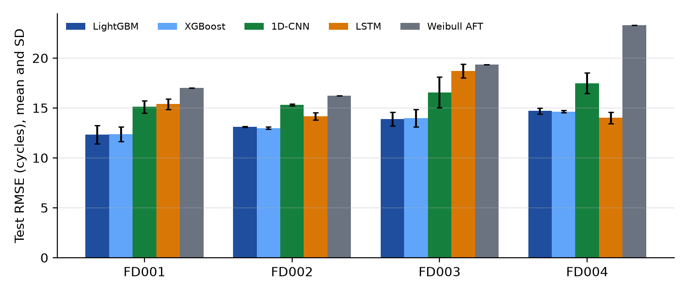
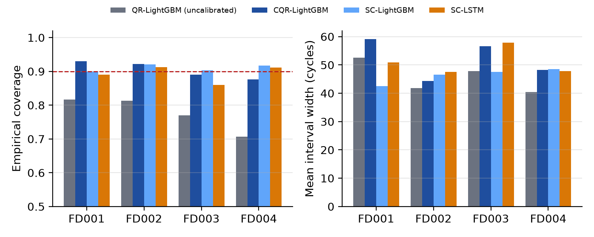
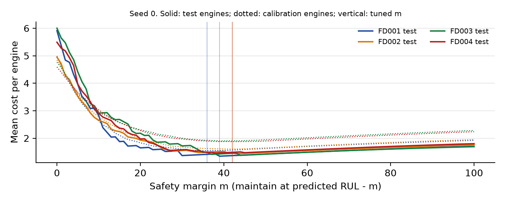

# turbofan-rul-conformal

[](https://github.com/rkesseku/turbofan-rul-conformal/actions/workflows/ci.yml)

**Uncertainty-aware predictive maintenance on NASA C-MAPSS.** The project predicts how many cycles a turbofan engine has left (its remaining useful life, RUL), wraps every prediction in a conformal interval with a finite-sample coverage guarantee, and turns predictions into maintenance decisions under an explicit cost model.

## Why this exists

Most RUL projects stop at an RMSE table. A maintenance planner needs two more things:

1. **How sure is the model?** A point estimate of "40 cycles left" is unusable without a range.
2. **When should I act?** Acting at the point estimate fails the engine roughly half the time, because half of all unbiased predictions are late.

This repo answers both questions on the standard benchmark, using the official test sets, and keeps the evaluation honest. Engines are split at the engine level, calibration engines are never used for training or model selection, early stopping uses held-out engines rather than random windows, every test engine contributes exactly one prediction, and RMSE is reported over three training seeds with a bootstrap confidence interval over test engines.

## Data

NASA's *Turbofan Engine Degradation Simulation Data Set* (C-MAPSS; Saxena, Goebel, Simon and Eklund, 2008) contains four subsets:

| Subset | Train engines | Test engines | Operating conditions | Fault modes |
|---|---|---|---|---|
| FD001 | 100 | 100 | 1 | 1 |
| FD002 | 260 | 259 | 6 | 1 |
| FD003 | 100 | 100 | 1 | 2 |
| FD004 | 249 | 248 | 6 | 2 |

Training engines run to failure. Test engines stop at some earlier point, and `RUL_FD00x.txt` gives their true remaining life. The data comes from the NASA Prognostics Center of Excellence data repository. It is not redistributed here: download it and unzip `CMAPSSData.zip` into `data/raw/cmapss/`.

## Method

- **Targets.** RUL is capped at 125 cycles. This is the usual piecewise-linear convention, because early-life degradation is not observable. Test RMSE is computed against the capped truth. Maintenance costs use the *uncapped* truth.
- **Split.** Training engines are split 75/25 at the engine level into *fit* and *calibration* sets (split seed 0, fixed for every run). No engine appears in both.
- **Model selection.** Within the fit engines, 15% of the *engines* are held out for early stopping and tuning, and the boosted models and networks train on the remaining fit engines. Because whole engines are held out, overlapping windows from one engine never sit on both sides, so the early-stopping signal does not leak. The held-out engines are redrawn for each training seed. Calibration and test engines are never used for training, early stopping or tuning.
- **Preprocessing.**
  - The three operating settings are clustered with k-means (6 clusters for FD002/FD004, 1 otherwise), and every sensor is standardised within its cluster.
  - Sensors are dropped if they are near-constant or have |Spearman ρ| < 0.05 with RUL on the fit engines.
  - Inputs are 30-cycle sliding windows plus a scaled cycle counter. Test engines shorter than 30 cycles are front-padded.
- **Models.** All are trained on the fit engines only:
  - LightGBM and XGBoost on per-channel window summaries (last, mean, std, min, max, slope, last-5 mean). Learning rate 0.03; the number of boosting rounds (at most 2000) is chosen by early stopping on the held-out fit engines (patience 100). The LightGBM 5% and 95% quantile models are stopped the same way on the quantile loss.
  - A 1D-CNN and a 2-layer LSTM in PyTorch on raw windows (CPU, at most 40 epochs, early stopping with patience 6 on the held-out fit engines). A small tuning grid, learning rate {1e-3, 3e-3} × width {32, 64} (64 is the original width), is scored on the held-out engines of the first seed; the chosen setting is reused for the other seeds.
  - A Weibull accelerated-failure-time survival baseline (`lifelines`) on PCA-reduced window features. Each (engine, cycle) snapshot is a subject whose duration is its remaining life. The predicted median is the point estimate. It has nothing to select, so it is fitted once on all fit engines.
- **Seeds.** Boosted models and networks are trained with three seeds (0, 1, 2); the seed sets model randomness and which fit engines are held out for early stopping. Tables report the mean over seeds, with the standard deviation (SD) for RMSE.
- **Uncertainty** (target 90% coverage, α = 0.1):
  - *Split conformal* on every model: the interval is prediction ± q, where q is the ⌈(n+1)(1−α)⌉-th smallest absolute residual on the calibration windows.
  - *Conformalized quantile regression* (CQR; Romano, Patterson and Candès, 2019) on LightGBM's 5% and 95% quantile models.
  - The raw quantile interval is also reported, to show what calibration fixes.
- **Decision layer.** At inspection, maintenance is scheduled `trigger` cycles ahead.
  - If the engine fails first (trigger ≥ true RUL), the cost is 10.
  - Otherwise the cost is 1 (a planned visit) plus 0.01 per cycle of useful life given up.
  - Four policies are compared on the test engines, all using LightGBM: trust the point estimate; use the split-conformal lower bound; use the CQR lower bound; use the point estimate minus a margin *m* tuned on the calibration engines.

## Results

All numbers come from one run of `turbofan run-all` (fit/calibration split seed 0; training seeds 0, 1, 2) and are stored in [`docs/results/metrics.json`](docs/results/metrics.json), together with every seed's value, the tuning grid and the selected rounds and epochs.

**Point accuracy: test RMSE in cycles, mean ± SD over three training seeds (bold: lowest mean)**

| Model | FD001 | FD002 | FD003 | FD004 |
|---|---|---|---|---|
| LightGBM | **12.33** ± 0.91 | 13.12 ± 0.06 | **13.89** ± 0.70 | 14.71 ± 0.29 |
| XGBoost | 12.39 ± 0.74 | **12.99** ± 0.13 | 13.99 ± 0.88 | 14.64 ± 0.13 |
| 1D-CNN | 15.11 ± 0.64 | 15.32 ± 0.10 | 16.57 ± 1.53 | 17.47 ± 1.03 |
| LSTM | 15.39 ± 0.53 | 14.16 ± 0.36 | 18.71 ± 0.69 | **14.01** ± 0.55 |
| Weibull AFT | 17.03 | 16.22 | 19.35 | 23.28 |

The Weibull model has no training randomness, so it has no SD. Seed-to-seed SDs (0.06–1.53 cycles) are smaller than test-engine sampling noise: the 95% bootstrap intervals over test engines for seed 0 span about 3–7 cycles (LightGBM: [10.3, 15.4], [11.7, 14.5], [11.7, 16.7], [12.6, 16.2]). Mean NASA asymmetric score for LightGBM: 230 / 736 / 373 / 1002 on FD001–FD004.

Gradient boosting is still the most accurate on FD001–FD003, by 1.2–2.8 cycles over the best network. On FD004 (six operating conditions, two fault modes) the LSTM has the lowest mean RMSE, 14.01 against 14.64 for XGBoost. That margin is small: it is about one seed SD, the LSTM beat both boosted models in two of three seeds, and its NASA score (1081), which penalises late predictions more heavily, is worse than LightGBM's (1002). The fair reading is that on FD004 the tuned LSTM and boosting are tied, not that the LSTM wins.

Engine-wise early stopping and the small tuning pass mainly helped the networks. Against the earlier single-seed run, which stopped on random windows and used fixed settings, the LSTM moved from 15.84 / 18.28 / 18.07 / 17.35 to 15.39 / 14.16 / 18.71 / 14.01, and the 1D-CNN from 16.27 / 18.60 / 19.16 / 19.22 to 15.11 / 15.32 / 16.57 / 17.47. The boosted models lost 0.03–0.60 cycles (LightGBM was 12.04 / 12.94 / 13.52 / 14.11). They now train on 85% of the fit engines and stop after 146–618 rounds instead of a fixed 600. The gap between the best boosted model and the best network shrank from 3.2–5.3 cycles to between −0.6 and 2.8.

Tuning choices, scored on held-out fit engines: the 1D-CNN picked learning rate 3e-3 and width 32 on every subset; the LSTM picked learning rate 1e-3, with width 64 on FD001, FD002 and FD004 and width 32 on FD003.

**Uncertainty: empirical coverage of 90% intervals on the test engines, mean over seeds (mean width in cycles; bold: closest to 0.90)**

| Interval | FD001 | FD002 | FD003 | FD004 |
|---|---|---|---|---|
| LightGBM 5–95% quantiles, uncalibrated | 0.817 (52.6) | 0.813 (41.8) | 0.770 (47.8) | 0.707 (40.5) |
| CQR on LightGBM | 0.930 (59.1) | 0.921 (44.4) | 0.890 (56.6) | 0.876 (48.2) |
| Split conformal, LightGBM | **0.900** (42.5) | 0.920 (46.5) | **0.903** (47.6) | 0.917 (48.5) |
| Split conformal, LSTM | 0.890 (50.9) | **0.912** (47.5) | 0.860 (57.9) | **0.911** (47.8) |

The raw quantile model under-covers (71–82% where 90% was asked for). Split conformal brings LightGBM to 0.90–0.92 on every subset. CQR reaches 0.88–0.93 but is no longer the narrower method: it is narrower than split conformal only on FD002, and on FD004 it is about as wide (48.2 against 48.5 cycles) and sits below target (0.876). Its width depends on the quantile models, and early stopping on held-out engines chose very different round counts for the 95% model across seeds (18 to 1240), so the raw quantile width varied by up to 26 cycles between seeds on FD001 and FD003. Where the LSTM is about as accurate as LightGBM (FD002, FD004), its split-conformal intervals are about as wide. Where it is less accurate (FD001, FD003), they are 8–10 cycles wider.

**Decisions: mean cost per test engine over seeds (failure rate; bold: lowest cost)**

| Policy (LightGBM) | FD001 | FD002 | FD003 | FD004 |
|---|---|---|---|---|
| Act at the point estimate | 5.91 (54.0%) | 4.79 (40.7%) | 6.15 (56.7%) | 5.48 (48.3%) |
| Act at the split-conformal lower bound | 1.60 (4.3%) | 1.72 (4.6%) | 1.83 (6.7%) | 1.70 (4.2%) |
| Act at the CQR lower bound | 1.72 (5.7%) | 1.71 (4.4%) | 1.99 (9.0%) | 2.08 (9.0%) |
| Margin tuned on calibration engines | **1.35** (0.3%, m=34–36) | **1.46** (0.4%, m=40–42) | **1.40** (0.7%, m=39–40) | **1.50** (0.4%, m=42–45) |

Trusting the point estimate costs 2.6–4.4 times as much as the uncertainty-aware policies. A conformal lower bound needs no cost model and already cuts failures to 4–9%. When the cost ratio is known, tuning the margin on held-out engines does best on all four subsets, at the price of giving up more useful life (32–46 cycles per engine on average, against 18–32 for the lower bounds). Compared with the single-seed run, the tuned margin is about as cheap (it cost 1.34 / 1.46 / 1.58 / 1.49 before) and the CQR lower bound is more expensive on every subset (it cost 1.48 / 1.66 / 1.65 / 1.90), following the wider CQR intervals.





A short summary is in [`docs/brief/brief.pdf`](docs/brief/brief.pdf).

## Limitations

- **Three seeds, one split.** The SDs cover training randomness and the choice of early-stopping engines. The fit/calibration split is fixed, and the bootstrap intervals (seed 0) cover test-engine sampling.
- **Modest network tuning.** The grid has four points and is scored on one seed's held-out engines. The CNN picked the smallest width and the larger learning rate on every subset, which is the corner of the grid, so it was not explored exhaustively. The networks are still small and CPU-trained.
- **Coverage is approximate.** Calibration windows from one engine are correlated, and test engines contribute one truncated snapshot each, so the exchangeability behind conformal guarantees holds only approximately. Seed-averaged coverage of the conformal intervals (excluding the Weibull model) ranged from 0.86 to 0.93, and individual seeds from 0.84 to 0.95.
- **Marginal coverage only.** Coverage is not guaranteed within RUL ranges or per engine.
- **Capped truth.** Coverage and RMSE use the capped (125-cycle) truth.
- **Illustrative costs.** The cost model (failure = 10× a planned visit, 0.01 per wasted cycle) is illustrative. Real fleets would plug in their own numbers.
- **Simulated data.** C-MAPSS is simulated. Results do not transfer to real engines without re-validation.

## How to run

```bash
pip install -e ".[dev]"          # Python 3.10-3.12
pytest                           # synthetic data only, under a minute
ruff check src tests
turbofan smoke                   # tiny end-to-end run on synthetic engines
turbofan run-all --data data/raw/cmapss --out docs/results   # full run: 3 seeds + tuning grid (CPU, 2 threads; about 2.5 h on a shared machine)
python docs/brief/make_figures.py
quarto render docs/brief/brief.qmd --to typst
```

Package layout: `data.py` (loading and RUL targets), `preprocess.py` (normalisation, windows, features), `models.py`, `conformal.py`, `metrics.py`, `decision.py`, `pipeline.py`, `plots.py`, `synthetic.py`, `cli.py`.

## References

- A. Saxena, K. Goebel, D. Simon, N. Eklund. *Damage propagation modeling for aircraft engine run-to-failure simulation.* International Conference on Prognostics and Health Management, 2008.
- Y. Romano, E. Patterson, E. Candès. *Conformalized quantile regression.* NeurIPS, 2019.

## License

MIT. See [LICENSE](LICENSE).
