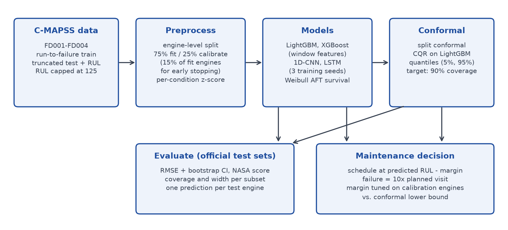
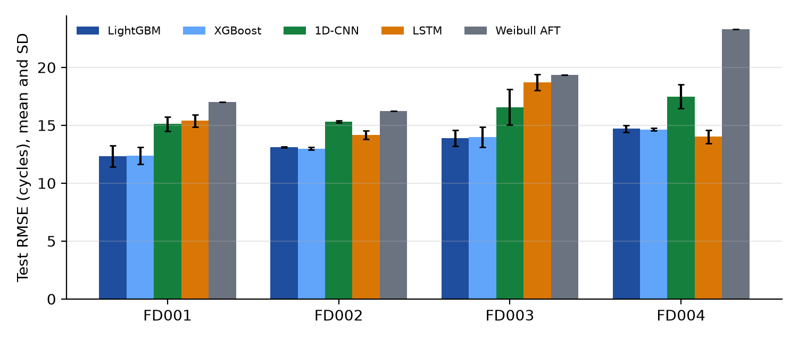
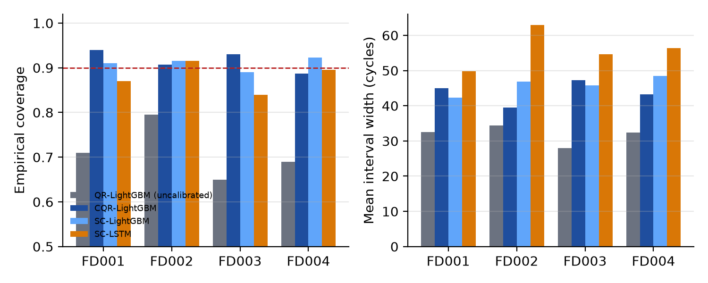
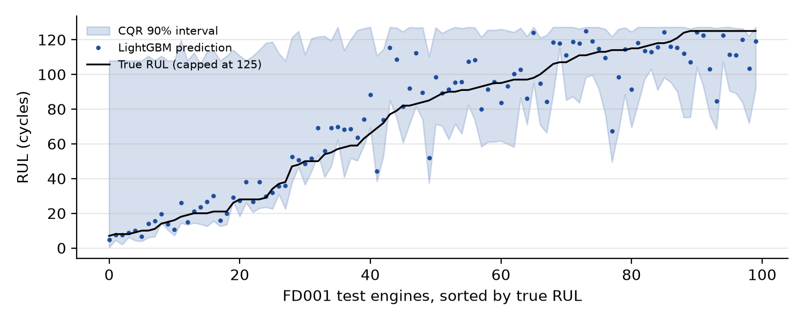
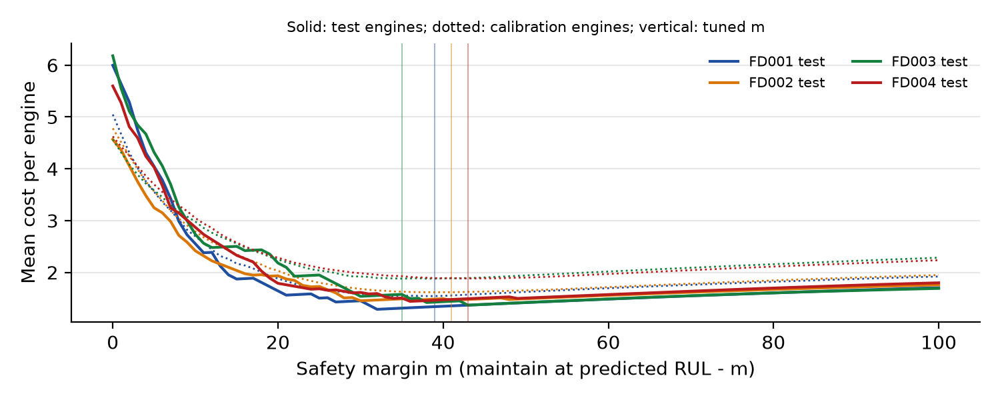

```{=typst}
#set text(hyphenate: false)
#set bibliography(title: "References")
#show bibliography: set par(justify: false)
// Three-rule tables (top, below header, bottom) and bold "Figure N" / "Table N" labels
#set table.hline(stroke: 0.6pt)
#show table: it => box(stroke: (top: 1pt, bottom: 1pt), it)
#show figure.caption: it => context [#strong[#it.supplement~#it.counter.display(it.numbering)#it.separator]#it.body]
#show table: set par(justify: false)
#show heading.where(level: 1): it => block(above: 1.2em, below: 0.6em)[
  #set text(fill: rgb("#1f4e9e"), size: 14pt, weight: "bold")
  #it
]
#show heading.where(level: 2): set text(fill: rgb("#2d2d2d"), size: 11.5pt)
#let glance(body) = block(fill: rgb("#eef3fb"), stroke: (left: 3pt + rgb("#1f4e9e")), inset: 10pt, radius: 2pt, width: 100%, body)
// Header: red title, subtitle, author, repository link
#align(center)[
  #set par(justify: false)
  #text(size: 17pt, weight: "bold", fill: rgb("#b91c1c"))[Turbofan Predictive Maintenance with Conformal Intervals]
  #v(0.5em)
  #text(size: 12pt, weight: "bold")[Predicting how long a jet engine has left, saying how sure we are, and deciding when to service it]
  #v(0.9em)
  #text(size: 11pt)[Reagan Kesseku, Ph.D.]
  #linebreak()
  #text(size: 10pt)[#link("https://github.com/rkesseku/turbofan-rul-conformal")[github.com/rkesseku/turbofan-rul-conformal]]
  #v(0.45em)
  #text(size: 9.5pt)[#emph[Keywords:] predictive maintenance; remaining useful life; conformal prediction; uncertainty quantification; C-MAPSS]
]
#v(0.5em)
```

```{=typst}
#glance[
*At a glance* \
*Problem:* Maintenance planners need to know how many cycles an engine has left, how certain that estimate is, and when to act. A single remaining-life number answers none of the last two. \
*What I built:* A pipeline on NASA's C-MAPSS turbofan benchmark that trains five remaining-useful-life (RUL) models (LightGBM, XGBoost, 1D-CNN, LSTM, Weibull survival model), wraps them in conformal prediction intervals with a finite-sample coverage guarantee, and converts predictions into maintenance decisions under an explicit cost model. \
*Headline result:* LightGBM reached test RMSE *12.0 / 12.9 / 13.5 / 14.1 cycles* on FD001–FD004. Raw 90% quantile intervals covered only 65–80% of engines; conformal calibration raised this to *0.89–0.94*. Acting at the point estimate let 38–57% of test engines fail; a margin tuned on held-out engines cut failures to *0–3%* and expected cost by *2.6–4.5×* relative to acting at the point estimate. One seed, simulated data (see limitations). \
*Stack:* Python, pandas, scikit-learn, LightGBM, XGBoost, PyTorch, lifelines, matplotlib, pytest, GitHub Actions. \
*Repo:* #link("https://github.com/rkesseku/turbofan-rul-conformal")[github.com/rkesseku/turbofan-rul-conformal]
]
```

# The problem

Jet engines wear out gradually. Sensors on the engine (temperatures, pressures, fan and core speeds) drift as components degrade, and an engine that is serviced too late fails in operation, which is expensive and disruptive. One that is serviced too early throws away useful life. *Predictive maintenance* uses the sensor history to estimate the **remaining useful life (RUL)**: the number of operating cycles until failure.

Most published RUL work reports a single accuracy number and stops. In practice that leaves two questions unanswered:

1. *How sure is the model?* "40 cycles left" means something very different if the plausible range is 35–45 or 5–75.
2. *When should we act?* If the model is unbiased, its prediction is too late about half the time. Scheduling maintenance exactly at the predicted failure point therefore lets roughly half the engines fail first.

This project answers both questions on the standard public benchmark, under an evaluation protocol designed not to flatter the model.

## The data

C-MAPSS [@saxena2008] is NASA's simulated turbofan degradation data set. It has four subsets, *FD001–FD004*, of increasing difficulty: one or six operating conditions (altitude, Mach number, throttle setting) and one or two fault modes. Each training engine runs from healthy to failure. Each test engine is cut off at an unknown point, and NASA provides its true remaining life. FD001 and FD003 have 100 test engines each, and FD002 and FD004 have 259 and 248. The data are simulated, so they contain no real fleet or personal information. They are a widely used, well-understood proxy for real engines.


# Approach

## Architecture

{#fig-arch width=72%}

## How it works, end to end

1. *Targets.* Each cycle's RUL is capped at 125 cycles, because degradation is invisible early in life (the standard piecewise-linear convention). Accuracy and coverage are scored against the capped truth. The maintenance costs use the true, uncapped remaining life.
2. *Engine-level split.* Training engines are divided 75/25 into *fit* and *calibration* sets, so no engine appears in both. This prevents the most common leak in RUL work, where windows from one engine land in both training and validation data.
3. *Normalisation.* In FD002 and FD004, the six operating conditions shift sensor readings far more than wear does. The three operating settings are clustered, each sensor is standardised within its cluster, and sensors that are constant or unrelated to RUL are dropped. Everything is fitted on fit engines only.
4. *Models.*
   - Gradient-boosted trees, LightGBM [@ke2017] and XGBoost [@chen2016xgboost], use summary features of the last 30 cycles: last value, mean, spread, minimum, maximum, trend slope and recent mean.
   - A 1D convolutional network and a two-layer LSTM read the raw 30-cycle window.
   - A Weibull accelerated-failure-time survival model, fitted with lifelines [@davidsonpilon2019], gives a classical reliability-engineering baseline.
5. *Conformal intervals.* Split conformal prediction [@lei2018] takes the calibration engines' absolute errors and widens each test prediction by the error quantile that guarantees 90% coverage in finite samples. *Conformalized quantile regression* (CQR) [@romano2019] does the same for LightGBM's 5% and 95% quantile models. Its intervals can be wider for uncertain engines and narrower for confident ones.
6. *Decisions.* When an engine is inspected, maintenance is scheduled some number of cycles ahead.
   - If the engine fails first, the cost is 10, standing for an unscheduled failure.
   - Otherwise the cost is 1 for the planned visit plus 0.01 for every cycle of useful life given up.
   - Four policies are compared: act at the point estimate; act at the split-conformal lower bound; act at the CQR lower bound; or subtract a safety margin chosen to minimise cost on the calibration engines.
7. *Evaluation.* Each official test engine contributes exactly one prediction, at its last observed cycle. RMSE carries a 95% bootstrap confidence interval over engines, and the PHM08 asymmetric score penalises late predictions more than early ones.


# Results

All numbers come from one run of `turbofan run-all` (seed 0) and are stored in `docs/results/metrics.json`.

## Point accuracy

| Model | FD001 | FD002 | FD003 | FD004 |
|---|---|---|---|---|
| LightGBM | **12.04** | **12.94** | **13.52** | **14.11** |
| XGBoost | 12.11 | 12.96 | 13.53 | 14.36 |
| 1D-CNN | 16.27 | 18.60 | 19.16 | 19.22 |
| LSTM | 15.84 | 18.28 | 18.07 | 17.35 |
| Weibull AFT | 17.03 | 16.22 | 19.35 | 23.28 |

: Test RMSE in cycles (lower is better). LightGBM 95% bootstrap intervals: FD001 [9.6, 14.3], FD002 [11.5, 14.3], FD003 [10.9, 15.9], FD004 [12.2, 16.1]. {#tbl-rmse}

{#fig-rmse width=72%}

With good window features, gradient boosting was the most accurate model on every subset, and on FD002 its confidence interval does not overlap either neural network's. The neural networks here are deliberately untuned baselines (one architecture, one seed, CPU-sized training), so this is a statement about this setup, not a verdict on sequence models in general. The survival model is weakest on the six-condition subsets, where a linear model on a few principal components cannot absorb the remaining structure.

## Uncertainty

| 90% interval | FD001 | FD002 | FD003 | FD004 |
|---|---|---|---|---|
| Raw quantiles | 0.71 (32.6) | 0.80 (34.3) | 0.65 (27.9) | 0.69 (32.3) |
| CQR, LightGBM | 0.94 (45.0) | 0.91 (39.5) | 0.93 (47.2) | 0.89 (43.3) |
| SC, LightGBM | 0.91 (42.4) | 0.92 (46.9) | 0.89 (45.8) | 0.92 (48.4) |
| SC, LSTM | 0.87 (49.8) | 0.92 (62.9) | 0.84 (54.6) | 0.90 (56.3) |

: Empirical coverage on the official test engines (mean width in cycles); target 0.90. SC = split conformal. {#tbl-cov}

{#fig-cov width=72%}

The raw quantile model is overconfident: its "90%" intervals contained the true RUL for only 65–80% of engines. Calibrating on held-out engines fixed this at a cost of 5–19 extra cycles of width. CQR was narrower than split conformal on the six-condition subsets. More accurate models also give narrower calibrated intervals: the LSTM's intervals are 7–16 cycles wider than LightGBM's, with similar or lower coverage.


{#fig-int width=64%}

## From predictions to maintenance decisions

| Policy (LightGBM) | FD001 | FD002 | FD003 | FD004 |
|---|---|---|---|---|
| Point estimate | 6.00 (55%) | 4.57 (38%) | 6.18 (57%) | 5.60 (50%) |
| SC lower bound | 1.57 (4%) | 1.73 (5%) | 1.94 (8%) | 1.68 (4%) |
| CQR lower bound | 1.48 (3%) | 1.66 (4%) | 1.65 (5%) | 1.90 (7%) |
| Tuned margin | **1.34** (0%) | **1.46** (0.4%) | **1.58** (3%) | **1.49** (0.4%) |

: Mean cost per test engine (share of engines that fail before maintenance). Tuned margins were 39, 41, 35 and 43 cycles. {#tbl-cost}

{#fig-cost width=62%}

Acting on the point estimate is the worst policy by a wide margin: about half of the engines fail first. A conformal lower bound needs no cost assumptions and already cuts failures to 3–8% and cost by 2.6–4.1×. When the cost ratio is known, a margin tuned on calibration engines is cheapest on every subset. The price is giving up more useful life, 31–46 cycles per engine on average against 20–32 for the lower bounds.


# What this demonstrates

- *Evaluation discipline.* Engine-level splits, a calibration set that no model trains on, official test sets used once, one prediction per engine, and bootstrap confidence intervals rather than bare point estimates.
- *Uncertainty quantification that is checked, not assumed.* Two conformal methods implemented from first principles and verified against a deliberately overconfident baseline, with a unit test confirming 90% coverage on synthetic data.
- *Decision-focused ML.* An explicit cost model, a policy tuned on held-out data, and an honest statement of what each policy trades away.
- *Engineering.* An installable package with a CLI, 10 tests on synthetic C-MAPSS-format data (no downloads in CI), ruff-clean code, and CI on Python 3.10–3.12.

# Limitations and next steps

- *One seed and one split.* The intervals reflect test-engine sampling, not training randomness. Repeating over seeds is the next step.
- *Approximate guarantee.* Conformal coverage assumes calibration and test points are exchangeable. Windows from one engine are correlated, and test engines are truncated snapshots, so the guarantee holds only approximately. Observed coverage ranged from 0.84 to 0.94. Weighted or engine-blocked calibration would tighten this.
- *Marginal coverage only.* Coverage is averaged over engines, not guaranteed within each RUL range. Coverage is also scored against the capped truth.
- *Untuned networks and illustrative costs.* The neural networks were not tuned, and the cost model (failure = 10× a planned visit, 0.01 per wasted cycle) is illustrative.
- *Simulated data.* C-MAPSS is simulated, so any real fleet application would need re-validation on real sensor data.

# How to run it

`pip install -e ".[dev]"`, then `pytest`, `turbofan smoke` (synthetic check) and `turbofan run-all --data data/raw/cmapss` (full run). Data: NASA Prognostics Center of Excellence repository (`CMAPSSData.zip` into `data/raw/cmapss/`).

